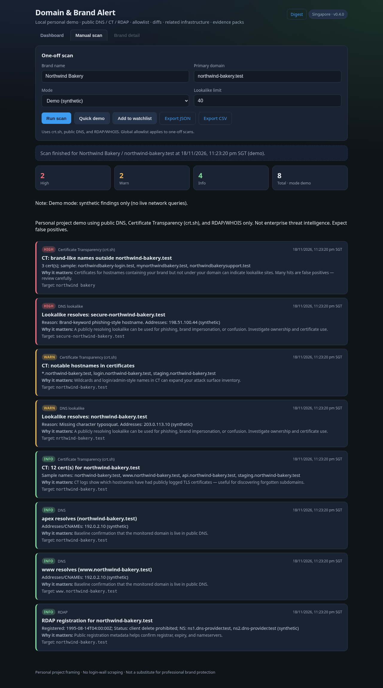
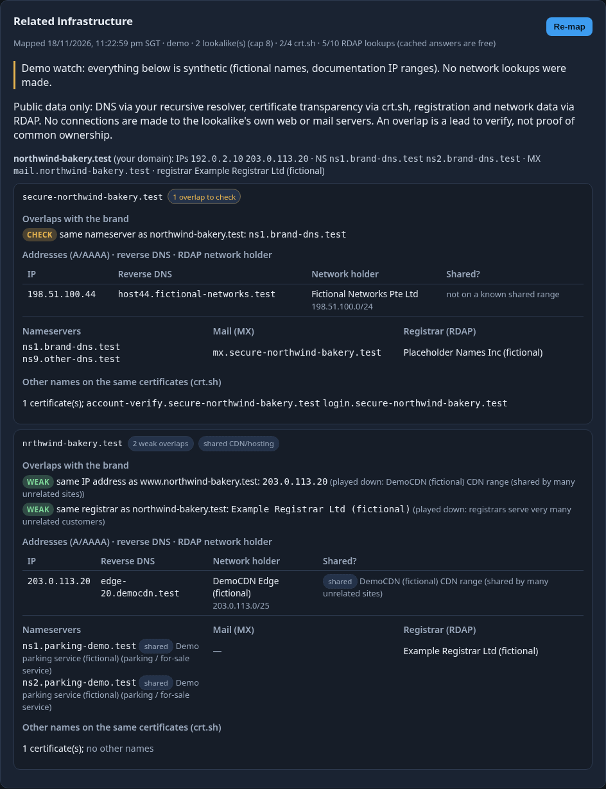

# Domain & Brand Alert (local MVP) — v0.5.0

A small local web app that watches brands + primary domains and surfaces **lookalike / brand-risk signals from public data only** (Certificate Transparency, DNS, RDAP/WHOIS).

## What I built

I wanted a lightweight way to keep an eye on lookalike domains for a few brands without paying for a monitoring service. This FastAPI app generates typosquat / homoglyph / TLD variants, checks them against public DNS, Certificate Transparency and RDAP, and keeps a local SQLite watchlist with scheduled re-scans, allowlists, "new since last scan" diffs, a local digest, and a one-click evidence-pack ZIP. It's a personal side project that runs locally.

> **Scope note:** public data only; results are heuristic signals with plenty of false positives, not attribution or takedown advice. Only monitor brands/domains you're authorised to watch.

## Features

1. Enter a **brand name** and **primary domain** (one-off scan) or add to a **persistent watchlist**
2. Public checks:
   - **Certificate Transparency** via [crt.sh](https://crt.sh) JSON API
   - **DNS** resolution for apex + `www`, plus generated lookalikes
   - **RDAP** (common TLDs) with **WHOIS** fallback via `python-whois` (skipped gracefully if blocked)
3. **Expanded lookalike generators**
   - Classic typosquats (missing / adjacent-key / doubled / transposed characters)
   - **Homoglyphs** (ASCII lookalikes like `0`/`o`, `rn`/`m`, plus IDN/punycode Latin lookalikes)
   - **Bit-flips** (single-bit flips that stay in `[a-z0-9-]`)
   - **TLD expansions**: `.co`, `.io`, `.ai`, `.sg`, `.com.sg`, `.net`, `.org`, `.info`, `.biz`
   - **Hyphen** insertion/removal
   - **Plural/singular** variants
   - Common **prefix/suffix** (`login-`, `secure-`, `support-`, …)
4. Results distinguish **priority** (how soon to look) from **confidence** (how strong the evidence is). Each finding shows its source, timestamp, why it matters, what triggered it, what could change the assessment, and a next analyst action. Exports retain severity as a priority rollup.
5. Export last scan as **JSON** or **CSV**
6. **Demo mode** with synthetic findings if live APIs are rate-limited or blocked
7. **Watchlist + scheduled re-scans** (SQLite + APScheduler / background thread fallback)
   - Add / remove / pause / resume watches
   - Configurable interval (minutes)
   - Scan history + “new” finding detection (fingerprint vs prior findings)
8. **Multi-brand dashboard** — last scan time, high-priority and new counts, priority filter, drill-in to brand detail
9. **Allowlist + diff alerts** (v0.3)
   - Persist allowlisted domains **per watch** or **globally**; matching finding targets are suppressed
   - Diff view / API surfaces only **NEW** findings since the previous scan (UI badge + `?new_only=true` / `/diff`)
   - **Local digest** at `/digest` — new findings since last view; mark-viewed clears the inbox
   - Optional **webhook URL** on each watch — POSTs JSON of new findings after a scan (skipped if empty / no new findings)
10. **Evidence pack export** (v0.3) — one-click ZIP per brand: metadata JSON, high findings CSV, all findings CSV, scan history, README
11. **Dashboard at `/`**: the app dashboard opens at `/` (also `/app` and `/dashboard`).
12. **Related infrastructure** (v0.4) — an expandable panel on each watch's detail page. For each resolving lookalike from the latest scan it shows:
    - A/AAAA, NS and MX records, plus reverse DNS for each address
    - the RDAP network holder for each address and the RDAP registrar for the domain
    - other names on the same certificates (crt.sh)
    - **overlaps with your own domain**: same IP, same nameserver, same registrar, or a certificate that also names one of your hosts
    - a **shared CDN/hosting** flag that plays an overlap down when the shared thing is a published CDN range (Cloudflare, Fastly), a bulk-hosting netblock, a managed DNS service or a parking service. Registrar matches are always treated as weak, because registrars serve huge numbers of customers.

    It runs as a capped background job (one at a time). The result is saved in SQLite and included in the evidence pack. A mapping runs automatically after a watch scan that found lookalikes (at most every 6 hours), or on demand from the panel. Demo watches replay synthetic fixtures (fictional names, documentation IP ranges) and make no network lookups.

    An overlap is a lead to verify, not proof that the same people run both domains.

## Requirements

- Python 3.10+
- `git` on your PATH: the shared collectors come from my [`osint-collectors`](https://github.com/N3bula04/osint-collectors) package, pinned to tag `v0.1.0` in `requirements.txt`.
- Network access for live mode (DNS + crt.sh + RDAP)

## How to run

```bash
git clone https://github.com/N3bula04/domain-brand-alert.git
cd domain-brand-alert
python3 -m venv .venv
source .venv/bin/activate
pip install -r requirements.txt
uvicorn app:app --host 127.0.0.1 --port 8765
```

Open http://127.0.0.1:8765/ and click **Quick demo**, or run the CLI demo first (no network lookups; fictional Northwind Bakery on `northwind-bakery.test`):

```bash
source .venv/bin/activate
python sample_run.py --mode demo
# writes sample_output/last_scan.json and sample_output/last_scan.csv
```

Live / auto scans need DNS, crt.sh and RDAP access. After the demo works:

```bash
python sample_run.py --brand Example --domain example.com --mode auto
```

### Tests

```bash
pip install -r requirements-dev.txt
python -m pytest -q
```

The tests never touch the internet. DNS, crt.sh and RDAP are replayed from fictional fixtures (`.test` names, RFC 5737 / RFC 3849 documentation addresses) or served by a fake HTTP server on 127.0.0.1. They cover 429 back-off, retries, caching, caps, overlap and shared-flag logic, and the background job API. GitHub Actions runs them on Python 3.10 and 3.12.

### Key URLs

| URL | Purpose |
|-----|---------|
| http://127.0.0.1:8765/ | Dashboard (also `/app`, `/dashboard`) |
| http://127.0.0.1:8765/digest | Local alert digest |
| http://127.0.0.1:8765/api/health | Health + version |
| http://127.0.0.1:8765/docs | OpenAPI (FastAPI) |

### Demo lookalike sample

```bash
python -c "from scanners.lookalikes import generate_lookalikes; \
print(len(generate_lookalikes('example.test','Example',limit=120))); \
print(generate_lookalikes('example.test','Example',limit=12))"
```

## Data sources (public only)

| Source | What | Notes |
|--------|------|--------|
| DNS | Apex / www / lookalike resolution; NS, MX, reverse DNS for related infrastructure | Your system's recursive resolver via `dnspython` |
| crt.sh | Certificate Transparency search | Free; often slow or rate-limited |
| RDAP | Registration and IP-network metadata | rdap.org first, then the server listed in IANA's RDAP bootstrap files (any TLD or RIR that publishes RDAP) |
| WHOIS | Fallback registration lookup | Many registries redact or block automation |

No paid WHOIS/OSINT APIs and no scraping of private or login-walled sites. The app **never connects to a lookalike's web, mail or app servers**: every lookup goes to a DNS resolver, crt.sh or an RDAP/WHOIS registry service.

### Rate limits, caps and caching

DNS, crt.sh and RDAP go through the shared `osint-collectors` package (`requests` + `dnspython`). Those calls block, so FastAPI routes run scans in worker threads, and related-infrastructure jobs run on one background worker thread.

- **Cache** in `data/cache/` (gitignored): DNS 1 h, crt.sh 6 h, RDAP 24 h. Only successful answers are cached; timeouts and errors are not.
- **Spacing**: at least 2 s between crt.sh requests and 1 s between RDAP requests, across all threads.
- **Per-scan caps**: 3 crt.sh queries, 1 RDAP domain lookup.
- **Per related-infrastructure job caps**: 8 lookalikes, 4 addresses per lookalike, 4 crt.sh queries, 10 RDAP lookups. Cached answers don't count. Anything skipped because of a cap is listed in the panel.
- **HTTP 429** is never retried. The `Retry-After` window is saved and that service is skipped until it ends. Timeouts and 5xx get one retry.

## Screenshots

| | |
|---|---|
| Dashboard / scan results |  |
| Related infrastructure (demo watch, synthetic data) |  |

Sample outputs (demo mode, fictional brand `Northwind Bakery` on the reserved `.test` TLD, documentation IP ranges): `sample_output/last_scan.json`, `sample_output/last_scan.csv`, `sample_output/lookalikes_sample.json`. Regenerate with `python sample_run.py --mode demo`.

## Persistence

- SQLite DB: `data/watchlist.db` (created on first start)
- Tables: `watches`, `scans`, `findings`, `allowlist`, `related_jobs` (v0.4; created automatically on existing DBs)
- Lookup cache: `data/cache/` (JSON files, gitignored, safe to delete)
- Soft migrations add `webhook_url`, `last_viewed_at`, `findings.suppressed` on existing DBs
- Scheduler polls ~every 60s and re-scans watches whose `interval_minutes` has elapsed (skipped when paused)

## API sketch

| Method | Path | Purpose |
|--------|------|---------|
| POST | `/api/scan` | One-off scan |
| GET | `/api/export/json\|csv` | Export last in-memory scan |
| GET | `/api/watches?severity=` | Dashboard list (`high` / `warn` / `new`) |
| POST | `/api/watches` | Add watch (`scan_now`, optional `webhook_url`) |
| GET/PATCH/DELETE | `/api/watches/{id}` | Read / update / remove (`?new_only=&mark_viewed=`) |
| POST | `/api/watches/{id}/pause\|resume\|scan` | Pause, resume, or force re-scan |
| GET | `/api/watches/{id}/history` | Scan history |
| GET | `/api/watches/{id}/diff` | New findings only (latest scan) |
| GET | `/api/watches/{id}/evidence-pack` | ZIP evidence pack download |
| GET | `/api/watches/{id}/related` | Latest related-infrastructure job + last finished result |
| POST | `/api/watches/{id}/related` | Queue a related-infrastructure job (202; returns the active job if one is already queued) |
| POST | `/api/watches/{id}/viewed` | Mark digest viewed |
| GET/POST | `/api/allowlist` | List / add allowlist (`watch_id` null = global) |
| DELETE | `/api/allowlist/{id}` | Remove allowlist entry |
| GET | `/api/digest?mark_viewed=` | Digest of new findings since last view |
| GET | `/api/scans/{id}?new_only=` | Full stored scan JSON |
| GET | `/api/scheduler` | Scheduler backend status |

### Webhook payload (when URL set and new findings exist)

```json
{
  "event": "new_findings",
  "version": "0.5.0",
  "watch_id": 1,
  "brand": "Example",
  "domain": "example.test",
  "scan_id": 3,
  "new_count": 2,
  "high_new": 1,
  "findings": [ /* … */ ],
  "timestamp": "…"
}
```

## Limitations

- High false-positive rate (shared brand words in CT, parked lookalikes, CDN shared IPs)
- Related-infrastructure overlaps are leads only. The shared-CDN/hosting/parking lists are short and hand-maintained, so some shared providers won't be recognised, and an "overlap to check" can still turn out to be coincidence. Registrant details are usually redacted, so ownership can't be confirmed from public data.
- crt.sh and some RDAP endpoints frequently timeout or throttle
- Lookalike generation is heuristic — not an exhaustive permutation engine
- Scheduler is local-process only (no distributed queue); intervals are best-effort
- Does not claim attribution, malware verdicts, or takedown capability
- Singapore framing is for local use; `.sg` RDAP may be unavailable from some networks

## Project layout

```
domain-brand-alert/
  app.py                 # FastAPI app + routes
  storage.py             # SQLite watches / history / allowlist / digest
  scheduler.py           # APScheduler or thread fallback
  sample_run.py          # CLI sample runner
  requirements.txt       # includes osint-collectors (git tag)
  requirements-dev.txt   # pytest, pyflakes
  CHANGELOG.md
  LICENSE
  data/                  # watchlist.db + cache/ (gitignored)
  scanners/
    collect.py           # osint-collectors runtime: cache, throttle, caps, User-Agent
    lookalikes.py
    dns_check.py
    ct_check.py
    rdap_check.py
    related_infra.py     # related-infrastructure mapper (live or fixture sources)
    related_demo.py      # synthetic fixtures for demo watches
    shared_infra.py      # CDN / hosting / managed-DNS / parking reference lists
    demo_data.py
  tests/                 # pytest suite + fictional fixtures
  .github/workflows/ci.yml
  templates/
    index.html           # dashboard + manual scan + detail
    digest.html          # local alert digest
  static/app.css
  static/app.js
  sample_output/
```

## License

MIT — see [LICENSE](LICENSE). Personal project; use responsibly and only for domains/brands you are authorised to monitor.
